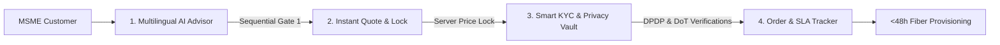

# Airtel Business: Project Udyam Digital
> **Enterprise Track A · AI-Driven Autonomous MSME Onboarding Engine**  
> *Transforming 17.6-day MSME sales cycles into <48-hour self-service activations.*

[](#privacy--compliance)
[](#multilingual-localization)
[](#quick-start)
[-success.svg)](#automated-testing)

---

## 🚀 Quick Start

Run the entire platform with zero external dependencies using native Node.js:

```bash
# 1. Start the server (serves web portal & APIs on port 3000)
npm start

# 2. Open in your browser
# Visit: http://localhost:3000
```

To run all automated verification test suites:
```bash
npm test
```

---

## 🎯 Executive Overview & Problem Solved

Traditional MSME telecom onboarding suffers from high drop-offs and friction:
- **68% drop-off** across lead qualification, manual quote negotiation, and physical KYC collection.
- **17.6-day average cycle** from initial lead to fiber activation, causing **3+ status-chasing calls** per customer.
- **High blended CAC** (~₹15,000 per customer) from field-intensive manual processing.

**Project Udyam Digital** introduces an autonomous, 4-stage sequential self-service journey:
1. **Multilingual AI Business Advisor**: 4-question conversational discovery matching business type, headcount, multi-site branches, and network gaps to Airtel's 25-product catalogue rules with context-aware rationales (zero hardcoded static packs).
2. **Instant Quote & 12-Month Price Lock**: Server-authoritative transparent pricing with GST breakdowns, waived setup fees, and real-time add-on toggling. Quote acceptance triggers an unalterable commercial agreement lock.
3. **Autonomous Smart KYC & Privacy Vault**: Live 4-document dossier processing (GSTIN, Udyam, Signatory ID, Address Proof). Real-time verification against National GSTN & MSME registries, DoT 90-day address proof currency compliance, DPDP Act 2023 digital consent capture, and cryptographic PAN/Aadhaar tokenization.
4. **Real-Time Order & Installation Tracker**: Self-service live milestone pipeline eliminating status-chasing calls, featuring dynamic confirmation timestamps, assigned Airtel field executive details, and a guaranteed <48-hour SLA window.

---

## 🛠️ System Architecture



### Architectural Highlights
- **Zero-Dependency Architecture**: Built using pure native Node.js HTTP server (`server.js`), running anywhere instantly without bloated `node_modules`.
- **Strict Sequential Stage Gating**: Customers cannot skip stages or access later tabs without verified stage completion. Once on Order Tracker, completed stages are reviewable in locked read-only mode.
- **Authoritative Server-Side Pricing**: Quote amounts and GST taxes are computed and locked on the server to prevent client-side price tampering.
- **DPDP Act 2023 Compliance**: Signatory PAN and Aadhaar are tokenized in memory and masked in logs/UI; raw sensitive documents are stored in encrypted vaults outside the public web root.

---

## 🌐 Multilingual Localization

Fully localized across **8 Indian Languages** with zero fallback corruption:
- **English** (India)
- **Hindi** (हिंदी)
- **Telugu** (తెలుగు)
- **Tamil** (தமிழ்)
- **Marathi** (मराठी)
- **Gujarati** (ગુજરાતી)
- **Bengali** (বাংলা)
- **Punjabi** (ਪੰਜਾਬੀ)

Dynamic language switching persists seamlessly across all wizard steps, quote line items, KYC badges, and tracker milestones.

---

## 🧪 Automated Testing & Verification

Run the comprehensive test suite verifying 97+ end-to-end assertions:

```bash
npm test
```

### Test Suites Included:
- [`scripts/verify_i18n.js`](scripts/verify_i18n.js): Validates 100% dictionary completeness across all 8 languages and 118 UI DOM elements.
- [`scripts/test_stage_progression_gate.js`](scripts/test_stage_progression_gate.js): Tests 30 progression gate assertions (blocking unauthorized tab navigation and enforcing review locks).
- [`scripts/test_clean_empty_kyc.js`](scripts/test_clean_empty_kyc.js): Verifies clean KYC dossier upload, dropzone removal, missing document guards, and registry status evaluations (Active, Suspended, Cancelled).
- [`scripts/test_kyc_http_api.js`](scripts/test_kyc_http_api.js): Tests RESTful HTTP verification and document intake endpoints.

---

## 📂 Repository File Structure

```
.
├── server.js                        # Zero-dependency Node.js HTTP application server
├── package.json                     # Project manifest and test/start scripts
├── .gitignore                       # Clean git configuration
├── Airtel_SYNC_Privacy_Security_Note.pdf # Official Track A 1-page compliance deliverable
│
├── public/                          # Production Web Portal
│   ├── index.html                   # Core single-page application UI
│   ├── app.js                       # Frontend state machine, wizard, & event handlers
│   ├── locales.js                   # 8-language localization dictionaries
│   ├── mock_registry_data.js        # Offline fallback dataset for mock registries
│   └── logo.jpeg                    # Official Airtel Business brand asset
│
├── locales/                         # Structured i18n JSON files
│   ├── en.json, hi.json, te.json, ta.json, mr.json, gu.json, bn.json, pa.json
│
├── services/                        # Modular Backend Services
│   ├── catalogueService.js          # Product catalogue rule evaluator
│   ├── kycService.js                # Smart KYC validation engine
│   ├── pricingService.js            # Authoritative pricing & quote generator
│   └── orderService.js              # Order tracker & SLA fulfillment manager
│
├── middleware/
│   └── security.js                  # DPDP compliance & security headers
│
├── storage/
│   └── private_uploads/             # Secure document vault (outside web root)
│
├── scripts/                         # Automated test suites (run via `npm test`)
│   ├── verify_i18n.js
│   ├── test_stage_progression_gate.js
│   ├── test_clean_empty_kyc.js
│   ├── test_kyc_http_api.js
│   ├── test_kyc_verification.js
│   └── test_remove_and_replace.js
│
├── kyc_documents/                   # 48 sample test dossier documents (K01–K12)
├── mock_gstin_registry.csv          # National GSTN mock database (3,534 records)
├── mock_udyam_registry.csv          # Ministry of MSME Udyam mock database (2,723 records)
├── product_catalogue.csv            # Airtel Business 25-product catalogue rules
├── smb_leads.csv                    # 5,000 synthetic SMB leads dataset
├── smart_kyc_validator.py           # Python reference KYC validator
└── solution_pipeline.py             # Solution analytics pipeline
```

---

## 📊 Dataset Reference (Track A Synthetic Pack)

All businesses, people, identifiers, and figures in this pack are synthetic and generated for the Airtel SYNC Hackathon:

| File | Records | Purpose |
| --- | --- | --- |
| `product_catalogue.csv` | 25 | Airtel Business products with pricing, setup fees, contract terms, eligibility rules, and dependencies. |
| `smb_leads.csv` | 5,000 | Fictional small-business leads with funnel stage reached, drop reason, and purchase history. |
| `mock_gstin_registry.csv` | 3,534 | Mock National GSTN tax registry. |
| `mock_udyam_registry.csv` | 2,723 | Mock Ministry of MSME Udyam registry. |
| `kyc_documents/` | 48 files | Specimen KYC documents for 12 applicants (K01–K12) featuring compliance edges and defects. |

---

## 🔒 Privacy & Regulatory Adherence
- **DPDP Act 2023**: Mandatory explicit digital consent checkbox before running KYC checks; real-time Aadhaar/PAN masking; document retention isolation.
- **DoT Currency Rule**: Automatic timestamp validation enforcing that utility address proofs do not exceed 90 days from the benchmark date.
